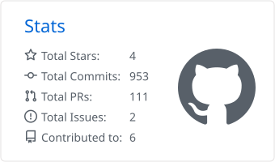
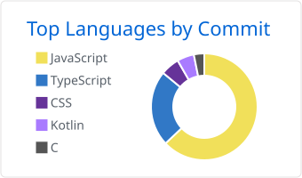

# Enrique Rodríguez del Real

**Software Engineer · Tech Operations @ Orange España · Madrid, ES**

🇪🇸 [Español](#-español) &nbsp;|&nbsp; 🇬🇧 [English](#-english)

---

## 🇪🇸 Español

### 👋 Sobre mí

Ingeniero de software en último curso de Ingeniería de Software en **U-TAD** y miembro de **Tech Operations en Orange España**. Me gusta construir cosas y entender cómo funcionan por dentro, tanto a nivel de código como de sistemas: desde un simulador de memoria caché en C hasta una app de finanzas desplegable en Docker.

- 🔭 Ahora mismo: seguir creciendo como ingeniero, automatizando y trabajando en proyectos reales.
- 🏆 Mi proyecto **Project Center U-tad** fue condecorado como uno de los 2 mejores de la universidad.
- 🖥️ Autohospedo mis propios servicios en servidores propios.
- 💬 Pregúntame sobre: sistemas, Linux, automatización, JavaScript/TypeScript y Docker.

### 🛠️ Stack

  

**También:** programación orientada a objetos · estructuras de datos y algoritmos · Scrum · ciberseguridad.

### 🚀 Proyectos destacados

| Proyecto | Qué es | Stack |
|---|---|---|
| 💰 [**FinanceMaster**](https://github.com/Ronambulo/FinanceMaster) | App de finanzas en Docker para **CasaOS y ZimaOS**, compatible con las exportaciones CSV de **Trade Republic**. | `TypeScript` `Docker` |
| 🎓 [**Project Center U-tad**](https://github.com/Ronambulo/Project-Center-U-tad) | Plataforma para el departamento de Proyectos de la universidad. **Condecorado como uno de los 2 mejores proyectos de la universidad.** | `JavaScript` |
| 📚 [**BibliotecaGO**](https://github.com/Ronambulo/BibliotecaGO6) | App Android nativa para el lector de tinta electrónica **BOOX Go 6**: explora tu servidor Calibre-Web por OPDS, descarga EPUB/PDF y léelos con o sin conexión. UI propia para E Ink sin animaciones, sincronización de leídos y APK firmado con CI. | `Kotlin` `Jetpack Compose` `Readium` |
| 🃏 [**Blackjack with Friends**](https://github.com/Ronambulo/blackjack-with-friends) | Juego que desarrollé para jugar con mis amigos y conocidos. Se juega a diario e incluye misiones, retos, logros, eventos festivos y minijuegos diarios. Desplegado en mi propio servidor con Docker. | `Next.js` `PWA` `Docker` |
| 🧠 [**Simulador Caché MEGATRONIX**](https://github.com/Ronambulo/Simulador-Cache-MEGATRONIX) | Simulador de memoria a bajo nivel. | `C` |

👉 Más en [**git.rodriguezdelreal.com**](https://git.rodriguezdelreal.com) y en mi [portfolio interactivo](https://rodriguezdelreal.com) (con estética VS Code).

### 📊 Estadísticas

  <picture>
    <source media="(prefers-color-scheme: dark)" srcset="./profile-summary-card-output/github_dark/3-stats.svg">
    
  </picture>
  <picture>
    <source media="(prefers-color-scheme: dark)" srcset="./profile-summary-card-output/github_dark/2-most-commit-language.svg">
    
  </picture>

### 📫 Contacto

¿Te apetece hablar, colaborar o preguntar algo? Escríbeme a **enrique@rodriguezdelreal.com** o por [LinkedIn](https://linkedin.com/in/enrique-rodriguez-del-real).

---

## 🇬🇧 English

### 👋 About me

Software engineer in my final year of a Software Engineering degree at **U-TAD**, working in **Tech Operations at Orange España**. I like building things and understanding how they work under the hood, at both code and systems level: from a cache memory simulator in C to a Docker-deployable finance app.

- 🔭 Currently: growing as an engineer, automating things and contributing to real-world projects.
- 🏆 My **Project Center U-tad** was awarded as one of the 2 best projects at the university.
- 🖥️ I self-host my own services on my own servers.
- 💬 Ask me about: systems, Linux, automation, JavaScript/TypeScript and Docker.

### 🛠️ Tech stack

  

**Also:** object-oriented programming · data structures & algorithms · Scrum · cybersecurity.

### 🚀 Featured projects

| Project | What it is | Stack |
|---|---|---|
| 💰 [**FinanceMaster**](https://github.com/Ronambulo/FinanceMaster) | Dockerized personal finance app for **CasaOS and ZimaOS**, compatible with **Trade Republic** CSV exports. | `TypeScript` `Docker` |
| 🎓 [**Project Center U-tad**](https://github.com/Ronambulo/Project-Center-U-tad) | Platform for the university's Projects department. **Awarded as one of the 2 best projects at the university.** | `JavaScript` |
| 📚 [**BibliotecaGO**](https://github.com/Ronambulo/BibliotecaGO6) | Native Android app for the **BOOX Go 6** e-ink reader: browse your Calibre-Web server via OPDS, download EPUB/PDF and read online or offline. Custom animation-free E Ink UI, two-way read-status sync and signed APKs via CI. | `Kotlin` `Jetpack Compose` `Readium` |
| 🃏 [**Blackjack with Friends**](https://github.com/Ronambulo/blackjack-with-friends) | A game I built to play with my friends and acquaintances. It's played daily and includes missions, challenges, achievements, holiday events and daily minigames. Deployed on my own server with Docker. | `Next.js` `PWA` `Docker` |
| 🧠 [**MEGATRONIX Cache Simulator**](https://github.com/Ronambulo/Simulador-Cache-MEGATRONIX) | Low-level memory simulator. | `C` |

👉 More at [**git.rodriguezdelreal.com**](https://git.rodriguezdelreal.com) and in my [interactive portfolio](https://rodriguezdelreal.com) (VS Code-inspired).

### 📊 Stats

  <picture>
    <source media="(prefers-color-scheme: dark)" srcset="./profile-summary-card-output/github_dark/3-stats.svg">
    
  </picture>
  <picture>
    <source media="(prefers-color-scheme: dark)" srcset="./profile-summary-card-output/github_dark/2-most-commit-language.svg">
    
  </picture>

### 📫 Get in touch

Want to chat, collaborate or ask something? Email me at **enrique@rodriguezdelreal.com** or reach out on [LinkedIn](https://linkedin.com/in/enrique-rodriguez-del-real).
